[SYNTHETIC SANDBOX FIXTURE - SAMPLE DATA ONLY: Helios Semiconductor]

# Receipts Due-Diligence Report: Helios Semiconductor

## Executive Decision

**Risk score: 76/100 (HIGH)**

DO NOT PROCEED as-is: resolve the red flags below or apply the Path to Greenlight mitigations before signing.

Sample mode reasoning (mock provider, not a live model). Task context: Vendor Helios Semiconductor scored 76/100 (HIGH). Verified claims: 4. Contradictions: 1. Summarize the decision.. Proceeding with the deterministic evidence pipeline; scores are computed from claims, not from this text.

## Transparent Math Breakdown

Scores are computed from VERIFIED claims only. Discarded claims contribute zero.

| Domain | Claim | Severity | Confidence | Contribution |
|---|---|---|---|---|
| FINANCIAL | Helios Semiconductor revenue fell 41.8 percent year over year. | 8.0 | 0.95 | 15.20 (8.0 x 2.0 x 0.95) |
| FINANCIAL | Helios Semiconductor cash flow is negative at minus 4.2 million dollars. | 6.5 | 0.95 | 12.35 (6.5 x 2.0 x 0.95) |
| LEGAL | Blog rumor of a counterfeit components lawsuit against Helios | 9.0 | 0.95 | 17.10 (9.0 x 2.0 x 0.95) |
| REPUTATION | Multiple customers report late deliveries and defective batches from Helios. | 6.0 | 0.90 | 6.48 (6.0 x 1.2 x 0.90) |
| Contradiction penalty | 1 CONTRADICTS edge(s) | | | 25.00 |

- Financial (capped at 35): 27.55
- Legal (capped at 25): 17.10
- Contradiction: 25.00
- Reputation (capped at 15): 6.48
- **Total: 76/100 (HIGH)**

## Evidence Graph

```mermaid
flowchart TD
    V[Helios Semiconductor]
    helios_semiconductor_FIN_1["helios-semiconductor-FIN-1<br/>FINANCIAL 8.0 conf 0.95<br/>VERIFIED"]
    V --> helios_semiconductor_FIN_1
    helios_semiconductor_FIN_2["helios-semiconductor-FIN-2<br/>FINANCIAL 6.5 conf 0.95<br/>VERIFIED"]
    V --> helios_semiconductor_FIN_2
    helios_semiconductor_LEG_1["helios-semiconductor-LEG-1<br/>LEGAL 9.0 conf 0.95<br/>VERIFIED"]
    V --> helios_semiconductor_LEG_1
    helios_semiconductor_LEG_2["helios-semiconductor-LEG-2<br/>LEGAL 8.5 conf 0.50<br/>DISCARDED"]
    V --> helios_semiconductor_LEG_2
    helios_semiconductor_REP_1["helios-semiconductor-REP-1<br/>REPUTATION 5.0 conf 0.90<br/>DISCARDED"]
    V --> helios_semiconductor_REP_1
    helios_semiconductor_REP_2["helios-semiconductor-REP-2<br/>REPUTATION 6.0 conf 0.90<br/>VERIFIED"]
    V --> helios_semiconductor_REP_2
    helios_semiconductor_FIN_1_EV1["helios-semiconductor-FIN-1-EV1<br/>ZETARIS_SQL"]
    helios_semiconductor_FIN_1_EV1 --> helios_semiconductor_FIN_1
    helios_semiconductor_FIN_2_EV1["helios-semiconductor-FIN-2-EV1<br/>ZETARIS_SQL"]
    helios_semiconductor_FIN_2_EV1 --> helios_semiconductor_FIN_2
    helios_semiconductor_LEG_1_EV1["helios-semiconductor-LEG-1-EV1<br/>NEWS_ARTICLE"]
    helios_semiconductor_LEG_1_EV1 --> helios_semiconductor_LEG_1
    helios_semiconductor_LEG_2_EV1["helios-semiconductor-LEG-2-EV1<br/>NEWS_ARTICLE"]
    helios_semiconductor_LEG_2_EV1 --> helios_semiconductor_LEG_2
    helios_semiconductor_REP_1_EV1["helios-semiconductor-REP-1-EV1<br/>COMPANY_PR"]
    helios_semiconductor_REP_1_EV1 --> helios_semiconductor_REP_1
    helios_semiconductor_REP_2_EV1["helios-semiconductor-REP-2-EV1<br/>CUSTOMER_REVIEW"]
    helios_semiconductor_REP_2_EV1 --> helios_semiconductor_REP_2
    helios_semiconductor_LEG_1_EV_PRIMARY["helios-semiconductor-LEG-1-EV-PRIMARY<br/>COURT_DOCKET"]
    helios_semiconductor_LEG_1_EV_PRIMARY --> helios_semiconductor_LEG_1
    helios_semiconductor_REP_1 -.->|contradicts| helios_semiconductor_FIN_1
```

## Verified Findings

- **[FINANCIAL] Helios Semiconductor revenue fell 41.8 percent year over year.** (severity 8.0, confidence 0.95)
  - Source: Zetaris corp_financials_2025, row revenue_yoy_pct
- **[FINANCIAL] Helios Semiconductor cash flow is negative at minus 4.2 million dollars.** (severity 6.5, confidence 0.95)
  - Source: Zetaris corp_financials_2025, row cash_flow_usd_m
- **[LEGAL] Blog rumor of a counterfeit components lawsuit against Helios** (severity 9.0, confidence 0.95)
  - Source: Industry blog report (secondary source)
  - Source: Delaware Docket #2025-CV-04912
- **[REPUTATION] Multiple customers report late deliveries and defective batches from Helios.** (severity 6.0, confidence 0.90)
  - Source: Aggregated customer reviews

## Red Flags

- Helios Semiconductor revenue fell 41.8 percent year over year. (severity 8.0)
- Helios Semiconductor cash flow is negative at minus 4.2 million dollars. (severity 6.5)
- Blog rumor of a counterfeit components lawsuit against Helios (severity 9.0)

## Path to Greenlight

If every mitigation below were applied, the score would fall from **76** to **24 (LOW)**.

| Red Flag | Mitigation Action | Recommended SLA / Contract Clause | Points Reduced |
|---|---|---|---|
| Helios Semiconductor revenue fell 41.8 percent year over year. | Require audited financial statements and a $100k escrow | Escrow + Right-to-Audit Clause | 15 |
| Helios Semiconductor cash flow is negative at minus 4.2 million dollars. | Require a bank guarantee and milestone based payments | Payment-on-Delivery Clause | 12 |
| Blog rumor of a counterfeit components lawsuit against Helios | Obtain an independent legal opinion and a full indemnity | Indemnity + Termination-for-Cause Clause | 15 |
| Company PR contradicts Zetaris data (PR claims growth while Zetaris shows revenue decline of -41.8 percent) | Require independent third party verification and a disclosure warranty | Disclosure Warranty Clause | 10 |

## Appendix: Rejected Rumors and Unverified Claims

These claims were challenged by the Evaluator and discarded after retries. They contribute zero to the score.

- Blog rumor that the Helios chief executive was arrested (retries: 2)
- Helios company press release: Record 30 percent growth this quarter. (retries: 0)

## Audit Trail

- Model / provider: sample-mock
- Sample mode: True
- Trace file: logs/traces.jsonl
- Generated at: 2026-10-22T13:20:26.068052Z
- Agents: PlannerAgent, FinancialExecutor, LegalExecutor, ReputationExecutor, EvaluatorAgent, WriterAgent
- Engines: World Model (evidence graph), Markovian (claim lifecycle)
