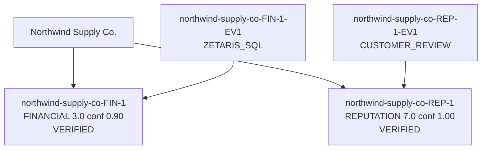

[SYNTHETIC SANDBOX FIXTURE - SAMPLE DATA ONLY: Northwind Supply Co.]

# Receipts Due-Diligence Report: Northwind Supply Co.

## Executive Decision

**Risk score: 14/100 (LOW)**

PROCEED: no material red flags found; standard onboarding checks still apply.

Sample mode reasoning (mock provider, not a live model). Task context: Vendor Northwind Supply Co. scored 14/100 (LOW). Verified claims: 2. Contradictions: 0. Summarize the decision.. Proceeding with the deterministic evidence pipeline; scores are computed from claims, not from this text.

## Transparent Math Breakdown

Scores are computed from VERIFIED claims only. Discarded claims contribute zero.

| Domain | Claim | Severity | Confidence | Contribution |
|---|---|---|---|---|
| FINANCIAL | Northwind Supply Co. revenue grew 6.4 percent year over year. | 3.0 | 0.90 | 5.40 (3.0 x 2.0 x 0.90) |
| REPUTATION | A small number of isolated customer complaints about delivery scheduling. | 7.0 | 1.00 | 8.40 (7.0 x 1.2 x 1.00) |
| Contradiction penalty | 0 CONTRADICTS edge(s) | | | 0.00 |

- Financial (capped at 35): 5.40
- Legal (capped at 25): 0.00
- Contradiction: 0.00
- Reputation (capped at 15): 8.40
- **Total: 14/100 (LOW)**

## Evidence Graph

## Verified Findings

- **[FINANCIAL] Northwind Supply Co. revenue grew 6.4 percent year over year.** (severity 3.0, confidence 0.90)
  - Source: Zetaris corp_financials_2025, row revenue_yoy_pct
- **[REPUTATION] A small number of isolated customer complaints about delivery scheduling.** (severity 7.0, confidence 1.00)
  - Source: Aggregated customer reviews

## Red Flags

- None.

## Path to Greenlight

If every mitigation below were applied, the score would fall from **14** to **14 (LOW)**.

| Red Flag | Mitigation Action | Recommended SLA / Contract Clause | Points Reduced |
|---|---|---|---|
| No red flags | No action required | - | 0 |

## Appendix: Rejected Rumors and Unverified Claims

These claims were challenged by the Evaluator and discarded after retries. They contribute zero to the score.

- None. Every proposed claim was verified.

## Audit Trail

- Model / provider: sample-mock
- Sample mode: True
- Trace file: logs/traces.jsonl
- Generated at: 2026-10-22T13:20:26.372687Z
- Agents: PlannerAgent, FinancialExecutor, LegalExecutor, ReputationExecutor, EvaluatorAgent, WriterAgent
- Engines: World Model (evidence graph), Markovian (claim lifecycle)
