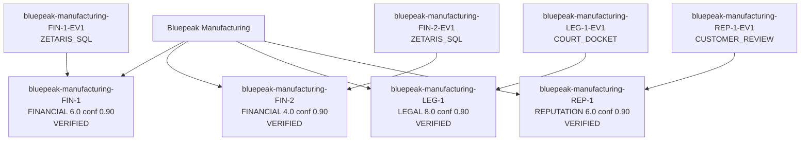

[SYNTHETIC SANDBOX FIXTURE - SAMPLE DATA ONLY: Bluepeak Manufacturing]

# Receipts Due-Diligence Report: Bluepeak Manufacturing

## Executive Decision

**Risk score: 39/100 (MODERATE)**

PROCEED WITH CONDITIONS: apply the mitigations below and monitor the flagged areas through onboarding.

Sample mode reasoning (mock provider, not a live model). Task context: Vendor Bluepeak Manufacturing scored 39/100 (MODERATE). Verified claims: 4. Contradictions: 0. Summarize the decision.. Proceeding with the deterministic evidence pipeline; scores are computed from claims, not from this text.

## Transparent Math Breakdown

Scores are computed from VERIFIED claims only. Discarded claims contribute zero.

| Domain | Claim | Severity | Confidence | Contribution |
|---|---|---|---|---|
| FINANCIAL | Bluepeak Manufacturing revenue fell 12.3 percent year over year. | 6.0 | 0.90 | 10.80 (6.0 x 2.0 x 0.90) |
| FINANCIAL | Bluepeak Manufacturing margins tightened by 3.1 percentage points. | 4.0 | 0.90 | 7.20 (4.0 x 2.0 x 0.90) |
| LEGAL | Supply contract dispute filed against Bluepeak | 8.0 | 0.90 | 14.40 (8.0 x 2.0 x 0.90) |
| REPUTATION | Mixed customer reviews: some praise product quality, others cite slow support responses. | 6.0 | 0.90 | 6.48 (6.0 x 1.2 x 0.90) |
| Contradiction penalty | 0 CONTRADICTS edge(s) | | | 0.00 |

- Financial (capped at 35): 18.00
- Legal (capped at 25): 14.40
- Contradiction: 0.00
- Reputation (capped at 15): 6.48
- **Total: 39/100 (MODERATE)**

## Evidence Graph

## Verified Findings

- **[FINANCIAL] Bluepeak Manufacturing revenue fell 12.3 percent year over year.** (severity 6.0, confidence 0.90)
  - Source: Zetaris corp_financials_2025, row revenue_yoy_pct
- **[FINANCIAL] Bluepeak Manufacturing margins tightened by 3.1 percentage points.** (severity 4.0, confidence 0.90)
  - Source: Zetaris corp_financials_2025, row margin_pressure_pct
- **[LEGAL] Supply contract dispute filed against Bluepeak** (severity 8.0, confidence 0.90)
  - Source: Filed court docket (primary source)
- **[REPUTATION] Mixed customer reviews: some praise product quality, others cite slow support responses.** (severity 6.0, confidence 0.90)
  - Source: Aggregated customer reviews

## Red Flags

- Bluepeak Manufacturing revenue fell 12.3 percent year over year. (severity 6.0)
- Supply contract dispute filed against Bluepeak (severity 8.0)

## Path to Greenlight

If every mitigation below were applied, the score would fall from **39** to **9 (LOW)**.

| Red Flag | Mitigation Action | Recommended SLA / Contract Clause | Points Reduced |
|---|---|---|---|
| Bluepeak Manufacturing revenue fell 12.3 percent year over year. | Require audited financial statements and a $100k escrow | Escrow + Right-to-Audit Clause | 15 |
| Supply contract dispute filed against Bluepeak | Obtain an independent legal opinion and a full indemnity | Indemnity + Termination-for-Cause Clause | 15 |

## Appendix: Rejected Rumors and Unverified Claims

These claims were challenged by the Evaluator and discarded after retries. They contribute zero to the score.

- None. Every proposed claim was verified.

## Audit Trail

- Model / provider: sample-mock
- Sample mode: True
- Trace file: logs/traces.jsonl
- Generated at: 2026-10-22T12:54:00.654856Z
- Agents: PlannerAgent, FinancialExecutor, LegalExecutor, ReputationExecutor, EvaluatorAgent, WriterAgent
- Engines: World Model (evidence graph), Markovian (claim lifecycle)
